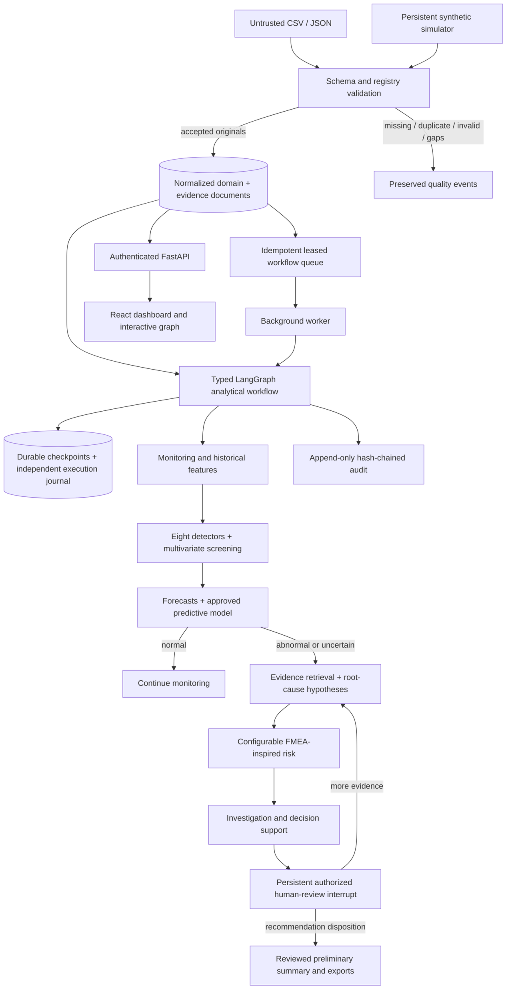

# Architecture

Analytical nodes receive detached state copies. Their declared output keys and strict typed state are validated before transitions. No agent has manufacturing-control, shell, batch-release or deviation-approval tools. Predictive screening also runs on in-range windows so early drift can be recognized before an excursion. Investigation and risk nodes are skipped for normal windows.

`DatabaseSaver` implements LangGraph checkpoint, pending-write and history persistence with typed serialization. SQLite uses a separate sibling workflow database so aborted application transactions cannot erase execution evidence. PostgreSQL can use the same database with separate checkpoint tables and independent transactions. Failed nodes are recoverable using the original event context; completed nodes are not replayed. Human reviews use LangGraph interrupts and attributed resume payloads, not an autonomous approval node.

The relational model covers processes, parameters, equipment, batches, sensor context, quality, anomalies, predictions, deviations, hypotheses, risks, workflows, executions, investigations, reviews, models/evaluations, reports, roles/permissions, sessions and audit. Canonical analytical evidence documents remain alongside normalized indexes to preserve complete original agent outputs and historical compatibility.

PostgreSQL workers claim queued or expired jobs using row locks and lease ownership. Same-event synchronous requests take a transaction advisory lock. Simulator state is stored centrally and tick claims lock its configuration row. SQLite local mode is single-process; distributed workers target PostgreSQL. Docker includes a separate worker and disables embedded polling in the backend.
